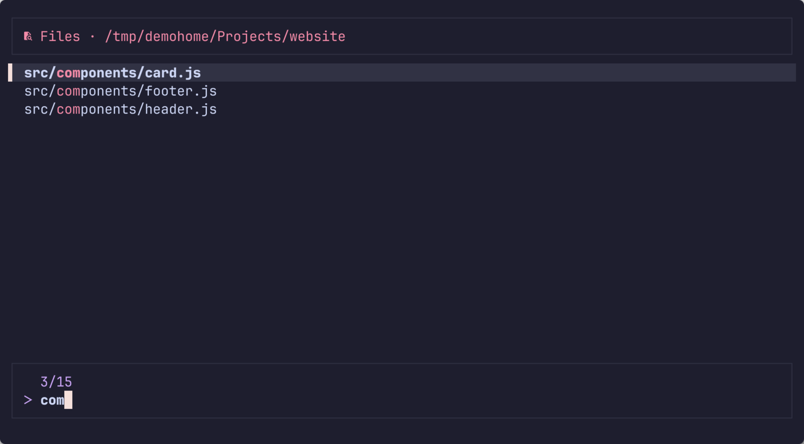

# finder.yazi

> File and folder pickers for Yazi with fzf, that look and work as your shell's fzf key bindings do.

[](https://github.com/yazi-contrib/finder.yazi/actions/workflows/ci.yml) [](https://github.com/yazi-contrib/finder.yazi/releases) [](LICENSE)



## Dependencies

- [Yazi](https://yazi-rs.github.io) (the latest release)
- [fzf](https://github.com/junegunn/fzf)
- [fd](https://github.com/sharkdp/fd) - optional: the picker of folders uses it when it is installed, and `find` when it is not

## Installation

```sh
ya pkg add yazi-contrib/finder
```

Or by hand, into the folder of your configuration of Yazi:

```sh
git clone https://github.com/yazi-contrib/finder.yazi ~/.config/yazi/plugins/finder.yazi
```

## Usage

Bind keys in `keymap.toml`:

```toml
[mgr]
prepend_keymap = [
  { on = "z", run = "plugin finder file", desc = "Find a file" },
  { on = "Z", run = "plugin finder dir", desc = "Find a folder" },
]
```

`plugin finder file` lists the files below the folder that Yazi shows, and `plugin finder dir` lists its
folders. What you choose is revealed in Yazi. `Esc` in fzf cancels, and nothing changes.

Yazi has its own `z` for fzf, which jumps to a file or a folder with `fzf -m`. This plugin is for when you
want the picker that your shell has, with the same command and the same options, and one picker for the files
and another for the folders.

## Configuration

### The variables of fzf

With no setup, the plugin uses the variables that fzf documents for its own key bindings, so Yazi looks and
finds as your shell does:

| Variable                                    | Used by                                     |
|---------------------------------------------|---------------------------------------------|
| `FZF_CTRL_T_COMMAND`, `FZF_CTRL_T_OPTS`     | `plugin finder file`, as Ctrl-T in the shell |
| `FZF_ALT_C_COMMAND`, `FZF_ALT_C_OPTS`       | `plugin finder dir`, as Alt-C in the shell   |
| `FZF_DEFAULT_OPTS`                          | both, before the options of the picker       |

With no command set, the picker of files lists what fzf lists, and the picker of folders runs `fd -t d`, or
`find . -type d` where `fd` is not installed.

Yazi must have the variables: if you start it from a launcher and not from your shell, it does not, so start it
from a shell, or set them where the launcher gets its environment.

### Setup

Optionally, in `init.lua`, and a value here wins over the variable of fzf:

```lua
require("finder"):setup {
  file = { command = "fd -t f", opts = "--preview 'bat --color=always {}'" },
  dir = { command = "fd -t d", opts = "--preview 'ls -la {}'" },
  tmux = "auto",
}
```

| Option         | Default  | Meaning                                                                       |
|----------------|----------|-------------------------------------------------------------------------------|
| `file.command` | variable | The command that lists the files                                              |
| `file.opts`    | variable | The options of fzf, after `FZF_DEFAULT_OPTS`                                  |
| `dir.command`  | variable | The command that lists the folders                                            |
| `dir.opts`     | variable | The options of fzf, after `FZF_DEFAULT_OPTS`                                  |
| `tmux`         | `"auto"` | `"auto"`: a popup of tmux (`--tmux`) when Yazi runs in tmux. `true`, or `false` |

### The folder in a footer

`FZF_CWD` is not a variable of fzf. If you set it, and your options name that folder, for example in a footer,
`--footer='Files · /home/me'`, the plugin writes the folder that Yazi shows in its place, so the footer says
where you are.

## How it works, and what can break

The plugin runs `fzf` in the folder, so the paths that it prints are relative to the folder, and no path is
put in a command line, so a folder with a space, a quote or a `;` in its name is no problem. Yazi's screen is
hidden while fzf is up, unless fzf is a popup of tmux.

The options of `setup` are read through `ya.sync`, as the code that runs async has a Lua state of its own, where
`setup` has not run. A new release of Yazi can change the functions that the plugin uses, so the tests run with
the latest Yazi in CI.

## Development

```sh
nix develop
bats tests/
```

The tests start Yazi in a detached tmux session with a configuration of its own that loads the plugin from this
folder. fzf runs with `--filter`, which prints the match and exits, so nothing is typed, and the tests check
which file or folder Yazi hovers afterwards.

## The yazi-contrib ecosystem

Plugins of Yazi, one repository for each: `viewer.yazi`, `layout.yazi`, `starship.yazi`, `finder.yazi`, `tailscale.yazi`.

## License

MIT
